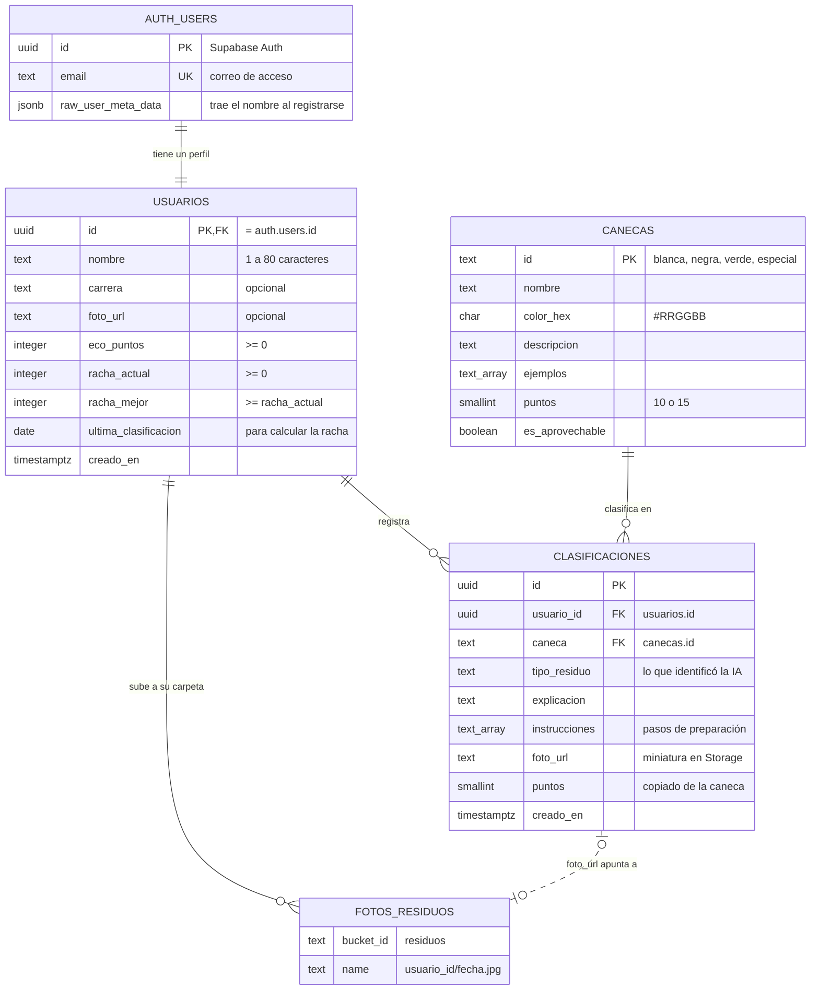

# Diagrama entidad-relación · EcoSnap

Modelo conceptual de la base de datos de EcoSnap, implementada en Supabase (PostgreSQL).
GitHub dibuja este diagrama automáticamente; la imagen `diagrama-er.png` es la misma versión exportada para el documento PDF.

## Cómo leerlo

| Relación | Cardinalidad | Qué significa |
|---|---|---|
| `auth.users` → `usuarios` | 1 a 1 | Cada cuenta de Supabase Auth tiene exactamente un perfil. Un trigger lo crea al registrarse y se borra en cascada con la cuenta. |
| `usuarios` → `clasificaciones` | 1 a muchos | Un estudiante registra cero o muchas clasificaciones; cada clasificación pertenece a un solo estudiante. |
| `canecas` → `clasificaciones` | 1 a muchos | Cada clasificación cae en exactamente una caneca del catálogo; una caneca aparece en muchas clasificaciones. |
| `usuarios` → fotos (Storage) | 1 a muchos | Las fotos se guardan en el bucket `residuos`, dentro de una carpeta con el id del usuario. |
| `clasificaciones` → fotos (Storage) | 0..1 a 0..1 | `foto_url` guarda la URL pública de la miniatura. Es opcional: si la foto no se pudo subir, la clasificación se guarda igual con `foto_url` vacío. No es una llave foránea porque Storage es un servicio aparte. |

La línea punteada indica una relación que no es una llave foránea de la base de datos.
